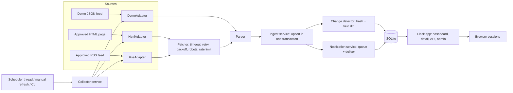
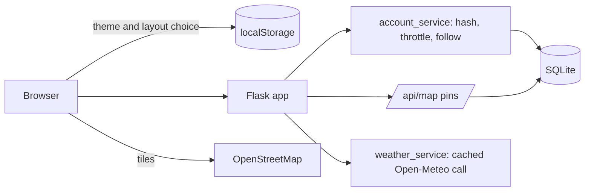

# Architecture and ER diagram

Diagrams use Mermaid. They render on GitHub, in VS Code (Markdown Preview Mermaid Support extension) and at https://mermaid.live.

## System architecture



## Entity-relationship diagram

```mermaid
erDiagram
  agencies ||--o{ sources : has
  sources ||--o{ notices : provides
  sources ||--o{ scraper_runs : logs
  notices ||--o{ notice_routes : "affects"
  notices ||--o{ notice_revisions : "has history"
  notices ||--o{ audit_events : records
  subscriptions ||--o{ notifications : receives
  notices ||--o{ notifications : triggers
  users ||--o{ user_routes : follows
  users ||--o{ subscriptions : owns
  notice_revisions ||--o{ notifications : "one per subscriber"
  agencies { int id PK  text code UK  text name  int is_demo }
  sources { int id PK  int agency_id FK  text code UK  text source_type  text url  int enabled  text last_success_at  text last_status }
  notices { int id PK  int source_id FK  text external_id  real latitude  real longitude  text content_hash  text valid_from  text valid_to  text withdrawn_at  text last_confirmed_at }
  notice_routes { int notice_id PK_FK  text route_id PK }
  notice_revisions { int id PK  int notice_id FK  int revision_no  text change_type  text change_summary  text changes_json }
  subscriptions { int id PK  int user_id FK  text route_filter  text channel  text email  int active }
  users { int id PK  text email UK  text password_hash  text created_at }
  user_routes { int user_id PK_FK  text route_id PK }
  notifications { int id PK  int subscription_id FK  int revision_id FK  text status  text alerted_at }
  scraper_runs { int id PK  int source_id FK  text status  int new_count  text error_message }
  audit_events { int id PK  int notice_id FK  text event_type  text created_at }
```

## Key constraints (checkpoint CP-3)

| Rule | Where |
|---|---|
| One notice per source and source-id | `UNIQUE (source_id, external_id)` on `notices` |
| One route row per notice and route | composite primary key on `notice_routes` |
| One revision number per notice | `UNIQUE (notice_id, revision_no)` |
| One alert per subscriber per revision | `UNIQUE (subscription_id, revision_id)` on `notifications` |
| End not before start | `CHECK` on `notices` |
| One account per e-mail (case-insensitive) | `UNIQUE COLLATE NOCASE` on `users.email` |
| One followed-route alert per user and route | partial unique index on `subscriptions (user_id, route_filter)` |
| Coordinates in range | `CHECK` on `notices.latitude` / `longitude` |
| Foreign keys enforced | `PRAGMA foreign_keys = ON` on every connection |

## Changes from the suggested structure

| Addition | Reason |
|---|---|
| `timeutil.py` | One place for UTC storage and local display, used by every layer |
| `scraper/adapters.py`, `scraper/demo_source.py` | The source-adapter interface the brief asks for, plus the demo feed |
| `services/ingest_service.py` | Keeps upsert and revision logic separate from queries |
| `services/collector_service.py` | Runs one source: log, collect, ingest, alert; shared by scheduler, button and CLI |
| `services/source_registry.py` | Syncs sources and refuses unapproved live sources |
| `templates/admin*.html` | Admin tools: scenarios, subscriptions, logs |

## Version 2 additions



| Addition | Reason |
|---|---|
| `services/account_service.py` | Sign-up, login throttling, followed routes, alert inbox |
| `services/weather_service.py` | Server-side weather call with cache; failures never produce invented values |
| `static/js/map.js`, `static/vendor/leaflet` | Map rendering without a CDN; the Content-Security-Policy stays strict |
| `database/migrations/002_*.sql` | Coordinates, users, followed routes, user-owned subscriptions |
